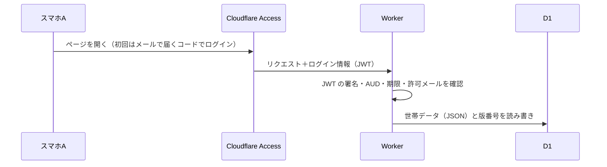

# 04. システム設計（v0.2）

> **このリポジトリは公開されています。** 実データは書かない。

## 1. 方針
| 項目 | 決定 | 理由 |
|------|------|------|
| 形態 | **Webアプリ（PWA）** | 夫婦とも iPhone。Safari の「ホーム画面に追加」でアプリのように使える。App Store の審査や開発者登録が不要 |
| ホスティング | **Cloudflare Pages**（無料枠） | 希望どおり。静的ファイルの配信は無料 |
| 夫婦での共有 | **Cloudflare Workers + D1**、認証は **Cloudflare Access**（無料枠） | Access でメールアドレスを2人分だけ許可すれば、ログイン画面を自作せずに済む |
| 計算 | ブラウザ内で実行（`app/src/engine`） | 個人データをサーバーで処理しない。オフラインでも動く |

## 2. 構成
```
app/
  src/engine/   計算エンジン（画面に依存しない純粋な TypeScript。N-07）
    types.ts      データモデル（docs/03 の §2）
    masters.ts    マスタデータ（口座の種類、教育費、年金・社会保険の値、シナリオ、プリセット）
    loan.ts       ローンの月ごとの返済計算
    simulate.ts   1年ごとのシミュレーション（docs/03 の §3）
    solve.ts      3つの問いの答え（老後・趣味予算・FIRE）
    sample.ts     架空のサンプル世帯
    engine.test.ts 検算のテスト
  src/worker.ts  重い探索（趣味予算の二分探索、FIRE の表）を Web Worker で計算
  src/ui/        画面（ホーム・推移・FIRE・入力）
  src/useHousehold.ts データの読み書きと同期（サーバー＋端末の控え）
  src/api.ts     サーバーの API の呼び出し
  src/storage.ts 端末の控え（localStorage）、ファイルの書き出し・読み込み
worker/          Cloudflare Worker（サーバー側）
  index.ts       入り口。/api/* 以外は画面のファイルを返す
  api.ts         API のルーティング
  auth.ts        Cloudflare Access のトークン（JWT）の検証
  store.ts       D1 への保存（版の管理・履歴）
  api.test.ts    認証と API のテスト
```

## 3. 共有の仕組み


| 項目 | 方式 |
|------|------|
| データの形 | 世帯データ（JSON）を1行で保存し、更新ごとに版番号を1つ上げる |
| 保存のタイミング | 入力が止まってから約1秒後に自動保存 |
| もう一方の更新の取り込み | アプリを開いた時・アプリに戻ってきた時に、新しい版があれば読み込む |
| 同時に編集したとき | 古い版からの保存はサーバーが拒否（409）。画面で「相手の内容を読み込む／自分の内容で上書き」を選ぶ |
| 変更履歴 | 直近50版を保存。設定画面から過去の版に戻せる |
| 認証 | Cloudflare Access がログインを担当。Worker でも JWT を検証し、許可したメールアドレス以外は拒否する。設定が欠けていれば API は動かない（安全側） |
| オフライン | 端末にも控えを保存するので、つながらなくても最後の内容は見られる（その間は端末だけに保存） |


## 4. 実装済みの範囲
**入っているもの**：要件定義書の Must のうち、計算と表示に関わるもの（F-01〜F-02、F-10〜F-19、F-20〜F-26、F-30〜F-32、F-35、F-40〜F-43、F-50〜F-52、F-60〜F-64）、夫婦での共有（N-02、N-04）、バックアップ（N-05）

**まだ入っていないもの**
- 毎月の実績入力と支出の逆算（F-70〜F-72）
- 繰上げ返済（F-33）
- 育休・時短の期間の入力画面（データと計算は対応済み）

## 5. 計算の簡易化
- 企業型DCの掛金は会社が出すものとし、家計の支出に含めない
- 国民健康保険の所得には年金収入を含めない。75歳以降の後期高齢者医療制度は考えない
- 老齢基礎年金は、退職後も60歳まで国民年金を払う前提で満額とする
- 余ったお金はすべて現預金に入る（自動で投資に回さない）

## 6. 公開と共有の設定手順
設定ファイルは `app/wrangler.jsonc`。Access の設定値は**公開リポジトリに書かず**、Cloudflare の管理画面でシークレットとして登録する。

### 6.1 デプロイ（Workers Builds）
- ルートディレクトリ：`app`
- ビルドコマンド：`npm run build`
- デプロイコマンド：`npx wrangler deploy`
- D1 データベース（`ourlifeplanning`）は、初回のデプロイで自動作成される。ビルドログに D1 の作成エラーが出た場合は、管理画面の D1 で同じ名前のデータベースを作り、その ID を `wrangler.jsonc` の `d1_databases` に `database_id` として追記する（ID は秘密情報ではない）

### 6.2 Cloudflare Access（ログイン）
1. Workers & Pages → ourlifeplanning → 設定 → ドメインとルート → `workers.dev` の行で **Cloudflare Access を有効化**
2. 表示される **AUD タグ** と **チームドメイン**（`◯◯.cloudflareaccess.com`）を控える
3. Zero Trust → Access → アプリケーション → 作成されたアプリのポリシーで、許可する人を**夫婦2人のメールアドレス**にする（ログイン方法はメールに届くワンタイムコードで十分）

### 6.3 Worker のシークレット
Workers & Pages → ourlifeplanning → 設定 → 変数とシークレット で、種類「シークレット」で登録する。

| 名前 | 値 |
|------|----|
| `ACCESS_TEAM_DOMAIN` | チームドメイン（例：`yourteam.cloudflareaccess.com`） |
| `ACCESS_AUD` | AUD タグ |
| `ALLOWED_EMAILS` | 夫婦のメールアドレスをカンマ区切りで |

### 6.4 使い始め
- 先に、入力済みのデータがあるスマホで開く（サーバーが空なら、その端末のデータが最初の共有データになる）
- もう一方のスマホで開くと、同じデータが表示される

### 6.5 ローカルで動かす
```sh
cd app
echo 'DEV_USER_EMAIL=dev@example.com' > .dev.vars   # localhost でだけ有効
npm run build && npx wrangler dev
```
